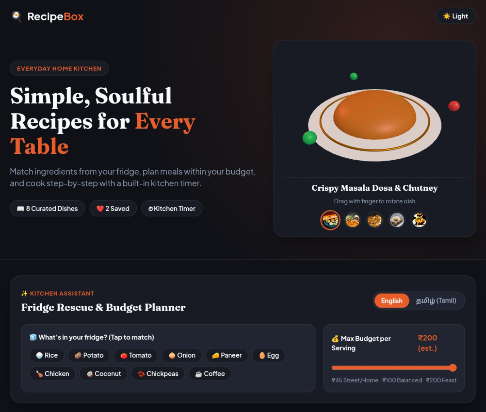
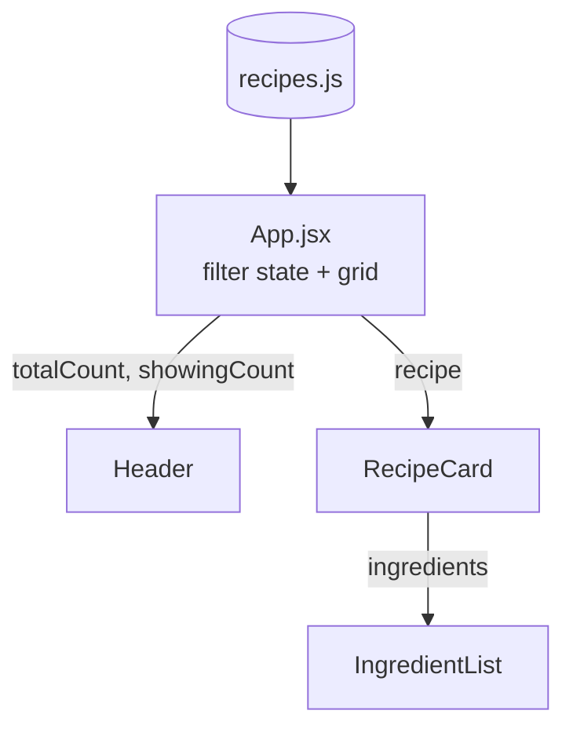

<div align="center">

# 🍳 RecipeBox

### Curated Kitchen Cards, built with React + Vite

A clean, responsive recipe showcase with prop-driven components, dietary filtering and an editorial culinary UI.


[**Live Demo**]( https://recipebox-psi-black.vercel.app/ ) [**Report Bug**](https://github.com/MADHUMITHA9971/PIXEL-FLAVOR-MATRIX/issues) · [**Request Feature**](https://github.com/MADHUMITHA9971/PIXEL-FLAVOR-MATRIX/issues)





</div>

---

## 📑 Table of Contents

- [About](#-about)
- [Features](#-features)
- [Tech Stack](#-tech-stack)
- [Architecture](#-architecture)
- [Project Structure](#-project-structure)
- [Getting Started](#-getting-started)
- [Roadmap](#-roadmap)
- [What I Learned](#-what-i-learned)
- [Author](#-author)

---

## 📖 About

**RecipeBox** is my Week 1 project for the **SkillMe Frontend Engineer Virtual Internship**. It focuses on the fundamentals of modern React:

- **Component-based design:** small, reusable, single-purpose components.
- **Unidirectional data flow:** no hardcoded recipe text in the UI; everything arrives via props from a single data file.
- **Dynamic list rendering:** `.map()` with stable `id` keys, with zero console warnings.

---

## ✨ Features

| Feature | Description |
|---|---|
| 🥦 **Dietary badges** | Veg / Non-Veg indicator on every card, driven by `veg: true \| false` |
| 🔍 **Diet filter** | Instantly switch between `All`, `Pure Veg` and `Non-Veg` |
| 📐 **Uniform cards** | Ingredient lists are capped at 4 items with a `+X more...` note, so every row stays aligned |
| 📱 **Responsive grid** | CSS Grid with `auto-fill, minmax(290px, 1fr)` adapts across mobile, tablet and desktop |
| ⚡ **Easily extensible** | Add one object to `recipes.js` and a new card appears automatically |

---

## 🧰 Tech Stack

- **Framework:** React 18
- **Build tool:** Vite 5
- **Styling:** Custom CSS (Grid, custom properties)
- **Typography:** Fraunces + Plus Jakarta Sans (Google Fonts)
- **Data:** Local JS module (`src/data/recipes.js`)

---

## 🧩 Architecture



| Component | Props | Responsibility |
|---|---|---|
| `Header` | `totalCount`, `showingCount` | Branding, tagline and live recipe counter |
| `RecipeCard` | `recipe` (object) | Image, category, cook time, diet badge and ingredients |
| `IngredientList` | `ingredients` (array) | Semantic `<ul>` capped at 4 items with overflow count |

**Recipe data shape**

```js
{
  id: 1,
  title: "Paneer Butter Masala",
  category: "Main Course",
  time: "40 min",
  veg: true,
  image: "https://...",
  ingredients: ["Paneer", "Tomato", "Butter", "Cream", "Spices"]
}
```

---

## 📂 Project Structure

```text
PIXEL-FLAVOR-MATRIX/
├── index.html                # Fonts + root mount
├── package.json
├── vite.config.js
└── src/
    ├── main.jsx              # React DOM entry
    ├── App.jsx               # Layout, filter state, responsive grid
    ├── App.css               # Theme, badges, grid styles
    ├── data/
    │   └── recipes.js        # 8 curated recipes
    └── components/
        ├── Header.jsx
        ├── RecipeCard.jsx
        └── IngredientList.jsx
```

---

## 🚀 Getting Started

**Prerequisites:** Node.js 18+ and npm

```bash
# 1. Clone the repository
git clone https://github.com/MADHUMITHA9971/PIXEL-FLAVOR-MATRIX.git
cd PIXEL-FLAVOR-MATRIX

# 2. Install dependencies
npm install

# 3. Start the dev server
npm run dev
```

Other scripts:

```bash
npm run build     # Production build
npm run preview   # Preview the production build
```

---

## 🗺️ Roadmap

- [x] Vite + React setup, cleaned of starter code
- [x] 8-recipe local dataset
- [x] Modular `Header`, `RecipeCard`, `IngredientList` components
- [x] `.map()` rendering with unique keys
- [x] Responsive equal-height grid
- [x] Veg / Non-Veg badges and dietary filter
- [ ] Search by recipe name or ingredient
- [ ] Recipe detail view / modal
- [ ] Dark mode
- [ ] Favorites saved in `localStorage`

---

## 💡 What I Learned

- Structuring a React app into small, reusable components
- Passing data down through props instead of hardcoding content
- Managing UI state (`useState`) for filtering
- Building responsive layouts with CSS Grid, without a framework

---

## 👩‍💻 Author

**Madhu Mitha**
Frontend Engineer Intern @ SkillMe

[


](https://github.com/MADHUMITHA9971)

---

<div align="center">

⭐ If you like this project, give it a star!

</div>